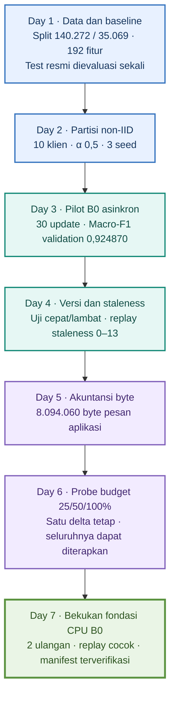

# Progres Minggu 1 — Fondasi B0 Asinkron

**Status:** Day 1–7 selesai sampai pembekuan fondasi pilot CPU B0 pada 11 Oktober 2026. Istilah *Day* mengikuti tahap rencana kerja, bukan hari kalender. Protokol eksperimen utama masih dijadwalkan untuk Day 14.

## Alur kerja Minggu 1

## Day 1 — Menyiapkan data dan baseline terpusat

**Tujuan:** memastikan data dapat diproses dan model dapat belajar sebelum masuk ke Federated Learning (FL). Baseline terpusat menjadi pemeriksaan awal alur data, pelatihan, dan evaluasi.

Pasangan CSV training dan test resmi UNSW-NB15 diperiksa skema, label, jumlah baris, serta hash SHA256-nya. Hash dipakai untuk mendeteksi perubahan berkas pada tahap berikutnya. Tugas dibatasi pada klasifikasi biner: `Normal=0` dan `Attack=1`. Kolom `id`, `attack_cat`, dan `label` dikeluarkan dari fitur agar identitas baris dan informasi jawaban tidak ikut dipelajari model.

Sebanyak 175.341 baris training dibagi secara stratified dengan seed 42 menjadi **140.272 baris train-fit** dan **35.069 baris validation**. Train-fit dipakai untuk belajar; validation untuk memeriksa hasil. StandardScaler untuk fitur numerik dan OneHotEncoder untuk fitur kategorikal hanya di-*fit* pada train-fit. Validation dan test memakai transformasi yang sudah tersimpan. Dengan cara ini, statistik data evaluasi tidak masuk ke proses belajar. Sebanyak 42 fitur sumber menghasilkan **192 fitur input** setelah encoding.

Model MLP memakai susunan `192 → 128 → 64 → 1`, dropout 0,1, Adam dengan learning rate 0,001, batch 512, dan 10 epoch. Checkpoint diambil dari epoch terakhir. Test resmi berisi 82.332 baris dievaluasi **sekali**, melalui langkah terpisah setelah checkpoint disimpan.

| Metrik | Validation | Test resmi |
| --- | ---: | ---: |
| Macro-F1 | 0,935908 | 0,834634 |
| Attack Recall | 0,978885 | 0,981007 |

Model berhasil mengenali sebagian besar serangan, tetapi **11.993 dari 37.000 sampel Normal** pada test salah ditandai sebagai Attack. Hasil ini menunjukkan bahwa alur pelatihan berfungsi, sekaligus mencatat masalah alarm palsu. Test tidak dipakai untuk memilih ulang model atau threshold. Day 2–7 tidak mengevaluasi test resmi lagi.

**Keluaran:** pipeline preprocessing, indeks split, urutan fitur, checkpoint, manifest, dan [hasil evaluasi baseline](../../../../results/processed/centralized_seed42_test.json). Artefak ini menjadi dasar yang dipakai ulang pada tahap FL.

## Day 2 — Membagi data ke sepuluh klien

**Tujuan:** menyiapkan pembagian data non-IID, yaitu kondisi ketika jumlah data dan proporsi kelas antar-klien berbeda. Kondisi ini diperlukan untuk menguji FL pada klien yang tidak memiliki data seragam.

Sebelum pembagian, pipeline, split, dan delapan fingerprint artefak Day 1 diperiksa kembali. Selanjutnya, 140.272 baris train-fit dibagi menggunakan Dirichlet `alpha=0.5` untuk **10 klien**, dengan seed partisi **42, 123, dan 2026**. Perubahan seed partisi tidak mengubah split validation Day 1. Seluruh baris train-fit harus muncul tepat sekali pada setiap partisi, tanpa tumpang tindih antar-klien dan tanpa memasukkan validation atau test.

| Seed partisi | Jumlah klien | Klien terkecil | Klien terbesar |
| ---: | ---: | ---: | ---: |
| 42 | 10 | 2.864 baris | 60.183 baris |
| 123 | 10 | 2.008 baris | 32.829 baris |
| 2026 | 10 | 959 baris | 56.959 baris |

Perbedaan ukuran klien cukup besar dan akan memengaruhi beban pelatihan lokal. Tidak ada klien kosong pada tiga partisi tersebut. Pengulangan dengan input dan seed yang sama menghasilkan alokasi serta CSV distribusi kelas yang identik. Pembagian ini merupakan simulasi ketimpangan label; belum mewakili distribusi klien jaringan nyata.

**Keluaran:** untuk setiap seed disimpan JSON alokasi indeks baris, CSV distribusi kelas, dan manifest sumber serta hash hasil. Rincian tersedia pada [catatan partisi](../../../../data/partitions/README.md). Pilot B0 berikutnya menggunakan partisi seed 42.

## Day 3 — Menjalankan pelatihan B0 asinkron

**Tujuan:** membuktikan bahwa server dapat menerima dan menerapkan pembaruan model tanpa menunggu semua klien selesai dalam satu putaran.

Klien dijalankan pada proses CPU terpisah. Setiap klien mengunduh model global beserta versinya, melakukan pelatihan lokal, lalu mengirim **delta**, yaitu selisih bobot model setelah pelatihan terhadap bobot yang diunduh. Server menerapkan delta berdasarkan urutan kedatangan. Klien yang sudah selesai dapat dipilih kembali sementara klien lain masih bekerja. Trainer, preprocessing, arsitektur MLP, dan metrik dari Day 1 dipakai ulang.

| Pengaturan pilot | Nilai |
| --- | --- |
| Kebijakan | B0 Async-Uniform; pemilihan seragam dari klien yang sedang idle |
| Seed / jumlah klien | 42 / 10 |
| Eksekusi bersamaan | Maksimum 3 pekerjaan; maksimum 1 pekerjaan aktif per klien |
| Model | MLP 192 → 128 → 64 → 1, dropout 0,2, FP32 |
| Pelatihan lokal | 1 epoch, batch 64, Adam 0,001; optimizer baru tiap penugasan |
| Budget update | 100% atau seluruh delta |
| Agregasi | `global += (jumlah_data_klien / 140272) × delta` |
| Batas pilot | 30 update diterima; seluruh pekerjaan yang sudah dikirim diselesaikan |

Agregasi memberi bobot sesuai jumlah data klien. Learning rate server dan pengali staleness sama-sama tetap 1,0. Pemilihan seragam berlaku bagi klien yang sedang idle, sehingga jumlah kontribusi tiap klien belum tentu sama.

Pilot menghasilkan **90 event**: 30 download, 30 arrival, dan 30 apply. Seluruh klien berkontribusi. `client_0` mengunduh versi 0 dan baru diterapkan pada versi 14; server sudah menerapkan 13 update lain sebelum klien tersebut selesai. Ini menjadi bukti bahwa pelatihan tidak tertahan oleh klien paling lambat.

| Versi server / update diterima | Macro-F1 validation |
| ---: | ---: |
| 0 | 0,242906 |
| 10 | 0,736445 |
| 20 | 0,920266 |
| 30 | 0,924870 |

Replay membaca kembali pesan dan urutan event tersimpan, lalu menghasilkan bobot akhir yang identik dengan checkpoint. Replay tidak melatih ulang klien. Hasil validation ini berasal dari pilot satu seed dan belum menjadi perbandingan kebijakan B0–B3.

**Keluaran:** [ringkasan pilot](../../../../results/processed/b0_day3_seed42.json), [hasil replay](../../../../results/processed/b0_day3_seed42_replay.json), serta pesan, event log, dan checkpoint di `results/raw/b0_day3_seed42/`.

## Day 4 — Memverifikasi versi dan staleness

**Tujuan:** memastikan setiap update dapat ditelusuri ke versi model asalnya dan tingkat ketertinggalannya dihitung dengan benar.

Staleness adalah jumlah perubahan versi server sejak model diunduh klien: `staleness = versi_server_saat_kedatangan − versi_awal_klien`. Nilai ini berbeda dari durasi pelatihan dalam detik. Versi server naik satu hanya setelah update valid diterapkan.

Uji terkontrol menahan klien lambat yang memakai versi 0, lalu membiarkan klien cepat menyelesaikan dua update terlebih dahulu:

| Kedatangan | Klien | Versi awal | Versi server saat tiba | Staleness | Versi setelah apply |
| ---: | --- | ---: | ---: | ---: | ---: |
| 1 | Cepat | 0 | 0 | 0 | 1 |
| 2 | Cepat | 1 | 1 | 0 | 2 |
| 3 | Lambat | 0 | 2 | 2 | 3 |

Update dengan tensor tidak valid ditolak tanpa mengubah bobot atau versi server. Event kedatangan dan penolakan tetap dicatat. Ringkasan staleness dihitung untuk update yang diterima, baik per klien maupun seluruh run.

Replay diperluas untuk memeriksa versi saat kedatangan, staleness, catatan apply, dan riwayat versi. Trace Day 3 kembali menghasilkan **30 update**, staleness minimum **0**, rata-rata **1,9**, maksimum **13**, serta model akhir identik. Verifikasi memakai bukti lama tanpa menjalankan pelatihan baru atau mengubah aturan agregasi.

**Keluaran:** [hasil verifikasi Day 4](../../../../results/processed/b0_day4_seed42_replay.json) dan pengujian versi/staleness. Tahap ini memverifikasi pengukuran ketertinggalan; belum menerapkan pengali agregasi yang adaptif terhadap staleness.

## Day 5 — Menghitung biaya komunikasi dalam byte

**Tujuan:** menyediakan ukuran komunikasi yang dapat diaudit sebelum menguji pengurangan ukuran update.

Setiap model download dan delta upload diserialisasi menjadi pesan aplikasi. Panjang byte pesan yang disimpan dan diteruskan ke proses klien dihitung secara langsung. Hitungan mencakup nilai tensor, header, serta metadata. Upload dan download dicatat terpisah, kemudian dijumlahkan. File checkpoint dan event log tidak dihitung sebagai komunikasi klien.

Pilot baru memakai pengaturan B0 Day 3 dan lokasi keluaran baru. Sebanyak **30 download dan 30 upload** menghasilkan:

| Komponen | Download | Upload |
| --- | ---: | ---: |
| Nilai tensor | 3.963.000 byte | 3.963.000 byte |
| Overhead serialisasi | 84.990 byte | 83.070 byte |
| Total pesan | **4.047.990 byte** | **4.046.070 byte** |

Total komunikasi yang dihitung adalah **8.094.060 byte**. Akumulasi byte juga dicatat pada titik evaluasi validation agar perkembangan kualitas model dapat dibaca bersama biaya pesan yang sudah digunakan. Replay mencocokkan panjang pesan, rincian overhead, akumulasi byte, dan bobot akhir.

Waktu serialisasi, pelatihan lokal, dan durasi keseluruhan run dicatat terpisah. Envelope internal IPC serta waktu transfer murni belum diukur; `transfer_seconds` tetap kosong (`null`). Karena itu, angka byte di sini berlaku untuk pesan aplikasi terserialisasi. Target Macro-F1 belum dibekukan, sehingga belum ada hasil *bytes-to-target*, yaitu biaya komunikasi sampai target kualitas tertentu tercapai.

**Keluaran:** [ringkasan byte Day 5](../../../../results/processed/b0_day5_seed42.json) dan [hasil replay](../../../../results/processed/b0_day5_seed42_replay.json). Pesan yang tersimpan menjadi sumber uji budget Day 6.

## Day 6 — Menguji budget update 25%, 50%, dan 100%

**Tujuan:** memeriksa apakah sebagian elemen delta dapat dikirim, direkonstruksi, dan diterapkan dengan benar, serta mengukur ukuran pesan yang sebenarnya.

Operator magnitude top-k memilih elemen dengan nilai absolut terbesar. Untuk setiap tensor berukuran `N`, budget `q` mempertahankan `ceil(q × N)` elemen. Jika nilainya sama, indeks yang lebih kecil dipilih lebih dahulu agar hasil konsisten. Pembulatan ke atas membuat tensor kecil dapat mempertahankan proporsi lebih besar dari budget nominal.

Budget 25% dan 50% mengirim nilai terpilih beserta indeks, bentuk tensor, tipe data, dan metadata. Penerima memeriksa pesan lalu mengisi posisi yang tidak dikirim dengan nol. Budget 100% memakai bentuk dense yang sudah digunakan B0, tanpa daftar indeks tambahan.

Uji dilakukan pada **satu delta Day 5 yang sama**, dengan model awal dan download yang sama untuk semua budget. Tidak ada pelatihan ulang. Setiap hasil rekonstruksi diterapkan pada server terpisah, lalu diperiksa pengaruh bobot agregasi dan kenaikan versinya.

| Budget pada satu delta Day 6 | Upload | Download | Total | Selisih dari 100% |
| ---: | ---: | ---: | ---: | ---: |
| 25% | 70.463 byte | 134.933 byte | 205.396 byte | Hemat 64.406 byte (23,872%) |
| 50% | 136.511 byte | 134.933 byte | 271.444 byte | Lebih besar 1.642 byte (0,609%) |
| 100% | 134.869 byte | 134.933 byte | 269.802 byte | Acuan |

Budget 50% lebih besar karena indeks `int32` memakai byte sebanyak nilai FP32 yang dipertahankan, ditambah overhead format sparse. Jadi, mengirim setengah elemen tidak otomatis berarti ukuran pesan menjadi setengah. Ketiga budget berhasil direkonstruksi dan diterapkan, tetapi uji satu delta ini belum mengukur dampak terhadap kualitas model selama pelatihan.

**Keluaran:** [laporan probe budget](../../../../results/processed/b0_day6_budget_probe_seed42.json), payload tiap budget, dan pengujian operator. B0 saat ini tetap memakai budget 100%; pemilihan budget berdasarkan demand belum diterapkan.

## Day 7 — Membekukan fondasi Minggu 1

**Tujuan:** menetapkan identitas fondasi pilot yang sudah diverifikasi agar tahap berikutnya dapat memakai data, komponen, dan aturan yang jelas.

Dua ulangan B0, A dan B, dijalankan dengan seed 42, konfigurasi serta input yang sama, dan tensor model awal yang identik. Lokasi keluaran dibedakan agar bukti setiap run tersimpan sendiri. Masing-masing run kemudian diperiksa melalui replay.

| Pemeriksaan | Ulangan A | Ulangan B |
| --- | ---: | ---: |
| Update diterima | 30 | 30 |
| Total byte pesan aplikasi | 8.094.060 | 8.094.060 |
| Staleness maksimum | 12 | 15 |
| Model akhir cocok dengan replay sendiri | Ya | Ya |

Urutan penyelesaian klien dipengaruhi penjadwalan proses, sehingga kedua run memiliki urutan kedatangan dan hash model akhir yang berbeda. Hal yang diverifikasi adalah kesamaan fondasi serta kecocokan setiap model akhir dengan replay dari urutan event-nya sendiri. Seed yang sama tidak menjamin urutan penyelesaian proses selalu identik.

Manifest pembekuan mencatat konfigurasi, hash data dan preprocessing, urutan fitur, model, optimizer, agregasi, batas pekerjaan bersamaan, serialisasi, operator budget, definisi evaluasi, serta skema event `download`, `arrival`, dan `apply`. Pemeriksa manifest memverifikasi kesesuaian komponen tersebut dengan bukti run dan laporan Day 6. Hash sumber mengikat isi berkas saat pembekuan, termasuk perubahan lokal yang saat itu belum di-commit.

**Keluaran:** [manifest pembekuan Minggu 1](../../../../results/processed/week1_backbone_freeze.json), ringkasan [ulangan A](../../../../results/processed/b0_day7_a_seed42.json) dan [ulangan B](../../../../results/processed/b0_day7_b_seed42.json), serta [replay A](../../../../results/processed/b0_day7_a_seed42_replay.json) dan [replay B](../../../../results/processed/b0_day7_b_seed42_replay.json). Verifikasi akhir Day 7 mencatat **136 tes lulus**, Ruff, build paket, replay, dan pemeriksa manifest lulus.

## Bukti dan batas lanjutan

Identitas sumber dapat ditelusuri melalui [manifest data](../../../../data/manifests/dataset.json) dan [manifest preprocessing](../../../../data/manifests/preprocessing.json). Log, pesan, dan checkpoint mentah berada di `results/raw/` dan tidak seluruhnya tersedia dalam Git. Reproduksi memerlukan artefak lokal yang sesuai dengan hash tersimpan.

Pembekuan ini berlaku untuk fondasi **pilot CPU B0**. Batas sumber daya, profil jaringan, aturan demand dan fairness, target Macro-F1, aturan berhenti, serta rencana analisis untuk eksperimen utama masih menunggu pilot atau keputusan Day 14. Belum ada perbandingan B0–B3 atau klaim efisiensi komunikasi jaringan. Langkah berikutnya adalah **Day 8 — pemantauan workload dan state klien** sebagai masukan bagi estimator demand.
