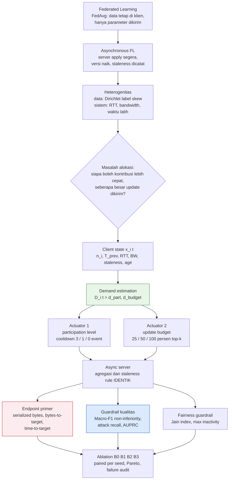
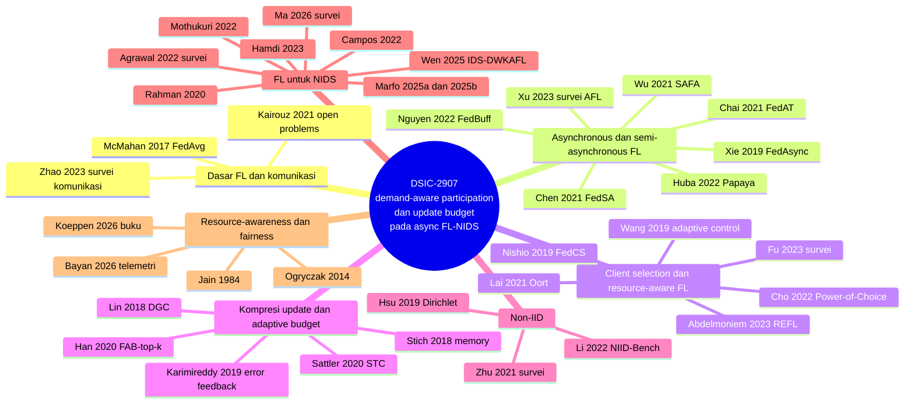
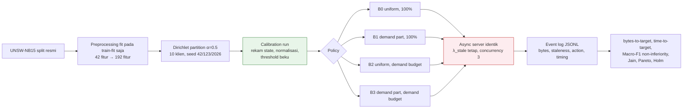

# Draft Teori Dasar, Formula Matematika, dan Tinjauan Pustaka — DSIC-2907

> **SUPERVISOR PROPOSED DRAFT — BUKAN BUKTI MAHASISWA.**
> Dokumen ini disusun oleh Supervisor 1 sebagai **bahan** penulisan bab Teori Dasar dan Related Work untuk skripsi dan artikel DSIC-2907 (Fadil). Mahasiswa tetap harus menulis ulang, memahami, dan mempertanggungjawabkan setiap kalimat dan sitasi. Dokumen ini tidak boleh disalin langsung ke naskah tanpa pemeriksaan sumber primer.

| Item | Keterangan |
|---|---|
| Topik | *Demand-Aware Adaptive Participation and Update Budgeting for Communication-Efficient Asynchronous Federated Network Intrusion Detection under Non-IID Data* |
| Backbone | Asynchronous Federated Learning (immediate apply, server versioning, staleness logging) |
| Dataset utama | UNSW-NB15, binary `normal` vs `attack`, 10 klien, Dirichlet label skew α = 0,5 |
| Sumber internal | `DSIC-2907/README.md`, `configs/*.yaml`, `src/async_server.py`, `src/compressor.py`, `paper/manuscript.md`, `paper/docs/Jurnal/Minggu 1/Progres-Minggu-1.md`, `paper/docs/Audit-DSIC-2907-Revisi.pdf` |
| Referensi mahasiswa (`paper/docs/Referensi/`) | 6 berkas: 5 artikel dan 1 buku; semuanya dibaca dan dipakai (§8.1) |
| Pustaka tambahan | 39 publikasi; metadata diverifikasi daring pada 2026-10-11 (§8.2 dan Lampiran A) |
| Jendela tinjauan pustaka | 2021–2026, ditambah karya seminal yang lebih lama dan ditandai eksplisit |
| Gambar | `figures/fig01`–`fig06` (PNG skematik) dan bagan Mermaid inline |
| Status | DRAFT v0.1 — menunggu keputusan Supervisor 1 pada §7 |

Catatan rendering: bagan Mermaid tampil di GitHub dan di VS Code dengan ekstensi *Markdown Preview Mermaid Support*. Gambar PNG tampil di semua pembaca Markdown.

---

## Daftar Isi

- [Draft Teori Dasar, Formula Matematika, dan Tinjauan Pustaka — DSIC-2907](#draft-teori-dasar-formula-matematika-dan-tinjauan-pustaka--dsic-2907)
  - [Daftar Isi](#daftar-isi)
  - [1. Peta Konsep Penelitian](#1-peta-konsep-penelitian)
  - [2. Teori Dasar](#2-teori-dasar)
    - [2.1 Federated Learning dan FedAvg](#21-federated-learning-dan-fedavg)
    - [2.2 Asynchronous FL: server versioning, staleness, dan aturan agregasi](#22-asynchronous-fl-server-versioning-staleness-dan-aturan-agregasi)
    - [2.3 Heterogenitas data: simulasi non-IID dengan Dirichlet label skew](#23-heterogenitas-data-simulasi-non-iid-dengan-dirichlet-label-skew)
    - [2.4 Heterogenitas sistem dan client selection sebagai masalah alokasi sumber daya](#24-heterogenitas-sistem-dan-client-selection-sebagai-masalah-alokasi-sumber-daya)
    - [2.5 Update budget: sparsifikasi top-k, error feedback, dan byte accounting](#25-update-budget-sparsifikasi-top-k-error-feedback-dan-byte-accounting)
    - [2.6 Resource-awareness, Pareto efficiency, fairness, dan QoS guardrail](#26-resource-awareness-pareto-efficiency-fairness-dan-qos-guardrail)
    - [2.7 Demand estimation dan action mapping](#27-demand-estimation-dan-action-mapping)
    - [2.8 Network Intrusion Detection dan metrik kualitas](#28-network-intrusion-detection-dan-metrik-kualitas)
    - [2.9 Landasan statistik: paired comparison, non-inferiority, bootstrap, Holm](#29-landasan-statistik-paired-comparison-non-inferiority-bootstrap-holm)
  - [3. Tinjauan Pustaka 2021–2026](#3-tinjauan-pustaka-20212026)
    - [3.1 Dasar FL dan masalah komunikasi](#31-dasar-fl-dan-masalah-komunikasi)
    - [3.2 Asynchronous dan semi-asynchronous FL](#32-asynchronous-dan-semi-asynchronous-fl)
    - [3.3 Client selection dan resource-aware FL](#33-client-selection-dan-resource-aware-fl)
    - [3.4 Kompresi update dan adaptive budget](#34-kompresi-update-dan-adaptive-budget)
    - [3.5 Non-IID](#35-non-iid)
    - [3.6 FL untuk NIDS](#36-fl-untuk-nids)
    - [3.7 Resource-awareness dan fairness](#37-resource-awareness-dan-fairness)
  - [4. Karya Terdekat dan Posisi DSIC-2907](#4-karya-terdekat-dan-posisi-dsic-2907)
    - [4.1 Marfo, Tosh, Moore, Suetterlein \& Manzano (2025a) \[R5\]](#41-marfo-tosh-moore-suetterlein--manzano-2025a-r5)
    - [4.2 Karya terdekat lain](#42-karya-terdekat-lain)
    - [4.3 Implikasi untuk klaim](#43-implikasi-untuk-klaim)
  - [5. Sintesis Research Gap](#5-sintesis-research-gap)
  - [6. Kerangka Formula Operasional Lengkap](#6-kerangka-formula-operasional-lengkap)
  - [7. Keputusan yang Memerlukan Supervisor 1](#7-keputusan-yang-memerlukan-supervisor-1)
  - [8. Daftar Pustaka](#8-daftar-pustaka)
    - [8.1 Referensi yang disediakan mahasiswa (`paper/docs/Referensi/`)](#81-referensi-yang-disediakan-mahasiswa-paperdocsreferensi)
    - [8.2 Pustaka tambahan](#82-pustaka-tambahan)
  - [Lampiran A — Log pencarian dan status verifikasi](#lampiran-a--log-pencarian-dan-status-verifikasi)
  - [Lampiran B — Notasi](#lampiran-b--notasi)

---

## 1. Peta Konsep Penelitian

Penelitian ini tidak mengusulkan algoritma asynchronous FL baru dan tidak mengusulkan algoritma sparsifikasi baru. Yang diuji adalah satu pertanyaan alokasi sumber daya: apakah keadaan klien yang dapat diamati dapat diubah menjadi *demand* yang mengatur dua sumber daya komunikasi, yaitu kesempatan berpartisipasi dan besar update, sehingga biaya komunikasi turun tanpa melanggar *guardrail* kualitas deteksi.

*Gambar 2. Satu modul demand menghasilkan dua keluaran untuk dua actuator yang berbeda. Local training, agregator, model, partisi, seed, dan network profile identik antar B0–B3.*

---

## 2. Teori Dasar

### 2.1 Federated Learning dan FedAvg

Federated Learning (FL) adalah skema pelatihan model di mana data tetap berada pada perangkat klien dan hanya parameter atau pembaruan model yang dikirim ke server (McMahan et al., 2017 [1]; Kairouz et al., 2021 [2]). Untuk $K$ klien dengan $n_k$ sampel lokal dan $n = \sum_k n_k$, tujuan global adalah

$$
\min_{w} F(w) \;=\; \sum_{k=1}^{K} \frac{n_k}{n}\, F_k(w), \qquad F_k(w) = \frac{1}{n_k}\sum_{j \in \mathcal{D}_k} \ell\!\left(w; x_j, y_j\right),
$$

dengan $\ell$ loss per sampel. Pada FedAvg, setiap *round* server memilih subset klien, klien menjalankan beberapa langkah SGD lokal dari model global $w^{(r)}$, lalu server merata-ratakan hasilnya dengan bobot $n_k/n$. McMahan et al. melaporkan pengurangan jumlah *communication round* 10 hingga 100 kali dibanding SGD tersinkronisasi dan ketahanan terhadap data non-IID dan tidak seimbang [1]. Survei Agrawal et al. (2022) yang tersedia pada folder referensi mahasiswa menempatkan FL sebagai teknik pelatihan terdesentralisasi yang menjaga privasi untuk IDS, sekaligus mencatat *communication overhead* sebagai tantangan utama karena "transmission cost of bulky model parameters and the lag in packet transmissions" [R3, §4.1].

Dalam DSIC-2907, FedAvg sinkron hanya berperan sebagai *reference context* (B4, opsional) dan bukan baseline kausal, karena perbandingan utama harus dilakukan di dalam backbone asinkron yang sama.

### 2.2 Asynchronous FL: server versioning, staleness, dan aturan agregasi

Pada FL sinkron, server menunggu seluruh klien terpilih sebelum agregasi, sehingga klien lambat (*straggler*) menentukan durasi round. Nishio & Yonetani (2019) menggambarkan masalah ini sebagai kondisi di mana "the server can complete the Aggregation step only after it receives all client updates" dan menolak solusi naif berupa *deadline* yang membuang update terlambat karena "will lead to the inefficient use of network bandwidths and waste the resources of delayed clients" [R2, §II]. Marfo et al. (2025) menyatakan hal serupa untuk anomaly detection: dalam mode sinkron "the global server must wait for all clients to complete their local training before model aggregation, resulting in increased idle times and communication overhead" [R5, §IV-B].

Asynchronous FL (AFL) menghapus *barrier* tersebut. Xie et al. (2019) memformulasikan FedAsync: server memperbarui model global dengan rata-rata berbobot antara model lama dan model yang baru tiba, dengan bobot campuran yang "set adaptively as a function of the staleness" [4]. Bentuk umumnya adalah

$$
w_{v+1} \;=\; (1 - \alpha_v)\, w_v \;+\; \alpha_v\, w_{\text{client}}, \qquad \alpha_v = \alpha \cdot s(\tau_v),
$$

dengan $\tau_v$ staleness dan $s(\cdot)$ fungsi penurun, misalnya polinomial $s(\tau) = (\tau+1)^{-a}$ atau *hinge*. Survei Xu et al. (2023) mengklasifikasikan varian AFL menurut heterogenitas perangkat, heterogenitas data, privasi, dan aplikasi [10]. Di antara titik tengah sinkron dan asinkron terdapat protokol *semi-asynchronous* seperti SAFA (Wu et al., 2021 [6]), FedAT dengan *tier* (Chai et al., 2021 [7]), dan FedBuff yang menyangga $K$ update sebelum menerapkannya agar kompatibel dengan *secure aggregation* (Nguyen et al., 2022 [8]). Huba et al. (2022) melaporkan dari produksi Meta bahwa pada konkurensi tinggi AFL "5× faster and has nearly 8× less communication overhead than synchronous FL" [9].

**Definisi staleness yang dipakai DSIC-2907.** Bila klien $i$ mengunduh model versi $v_{\text{start}}$ dan update-nya tiba saat versi server adalah $v_{\text{arrival}}$, maka

$$
\tau_i \;=\; v_{\text{arrival}} - v_{\text{start}} \;\ge\; 0 .
$$

Setiap *accepted update* menaikkan versi server tepat satu; update yang ditolak tidak menaikkan versi (diverifikasi pada Day 4 Progres Minggu 1). Implementasi `src/async_server.py` menerapkan update sebagai

$$
w_{v+1} \;=\; w_v \;+\; \eta \cdot \frac{n_i}{n} \cdot \lambda_{\text{stale}} \cdot \Delta_i, \qquad \Delta_i = w_i^{\text{local}} - w_{v_{\text{start}}},
$$

dengan $\lambda_{\text{stale}} \in (0, 1]$ **tetap** (`staleness_weighting: fixed` pada `configs/async_fl.yaml`), $\eta$ learning rate server, dan $n_i/n$ bobot proporsional sampel. Pilihan $\lambda$ tetap bersifat sengaja: aturan staleness harus identik antar B0–B3 agar efek yang diukur hanya berasal dari mekanisme demand. Konsekuensinya, penelitian ini **tidak** mengklaim kontribusi pada *staleness-aware aggregation* (FedSA, Chen et al., 2021 [5]; REFL, Abdelmoniem et al., 2023 [11]); staleness hanya diukur dan dilaporkan, serta menjadi salah satu fitur state.

*Gambar 1. Server tidak menunggu klien lambat. Staleness dihitung dari versi server saat update tiba dikurangi versi model yang diunduh klien.*

### 2.3 Heterogenitas data: simulasi non-IID dengan Dirichlet label skew

Data antar-klien pada FL umumnya tidak independen dan tidak identik terdistribusi (non-IID). Zhu et al. (2021) mensurvei dampaknya pada model parametrik dan non-parametrik serta metode penanganannya [23]. Agrawal et al. (2022) menghubungkan non-IID dengan *false alarm* tinggi pada IDS: "the variance in the large data itself may cause improper training of the local and global models, causing a high number of false alarms" dan "asymmetrically trained local models" [R3, §4.3].

Untuk mensimulasikan *label skew*, Hsu et al. (2019) memperkenalkan partisi Dirichlet [22], yang kemudian dibakukan oleh Li et al. (2022) dalam NIID-Bench sebagai *distribution-based label imbalance* [24]. Untuk setiap kelas $c$ ditarik vektor proporsi

$$
\mathbf{q}_c \;\sim\; \mathrm{Dir}\!\left(\alpha \cdot \mathbf{1}_K\right), \qquad \sum_{k=1}^{K} q_{c,k} = 1,
$$

lalu fraksi $q_{c,k}$ dari sampel kelas $c$ dialokasikan ke klien $k$. Parameter konsentrasi $\alpha$ mengatur derajat kemiringan: $\alpha \to 0$ membuat tiap klien didominasi sedikit kelas, $\alpha \to \infty$ mendekati IID. DSIC-2907 memakai $\alpha = 0{,}5$ sebagai kondisi utama dan $\alpha \in \{0{,}1;\, 10\}$ sebagai *robustness*, pada 10 klien dan tiga seed, dengan seluruh 140.272 baris *train-fit* tercakup tepat sekali (Day 2). Karena tugasnya biner, label skew berarti rasio `normal:attack` berbeda antar klien; ini relevan bagi NIDS karena klien yang jarang terpilih dapat membawa pola serangan yang tidak dominan pada klien lain (README §15). Istilah yang dipakai harus tetap *simulated non-IID label skew*, bukan klaim distribusi NIDS dunia nyata.

### 2.4 Heterogenitas sistem dan client selection sebagai masalah alokasi sumber daya

Selain data, klien berbeda dalam komputasi dan jaringan. Wang et al. (2019) merumuskan kendali adaptif antara jumlah update lokal dan agregasi global di bawah anggaran sumber daya pada *edge computing* [12]. Nishio & Yonetani (2019) memformulasikan FedCS: server meminta informasi sumber daya (kondisi kanal, kapasitas komputasi, ukuran data), lalu memilih klien secara *greedy* agar "the server can aggregate as many client updates as possible within a specified deadline" [R2, §III-C]. Oort (Lai et al., 2021) memilih peserta berdasarkan utilitas data dan kecepatan perangkat, dengan peningkatan *time-to-accuracy* 1,2 hingga 14,1 kali [13]. Cho et al. (2022) membuktikan bahwa seleksi yang bias ke klien ber-loss tinggi mempercepat konvergensi dan memperkenalkan Power-of-Choice [14]. REFL (Abdelmoniem et al., 2023) memprioritaskan peserta yang jarang tersedia demi keragaman sumber daya dan tetap memakai update terlambat dengan bobot yang diskalakan [11]. Fu et al. (2023) merangkum prinsip, tantangan, dan peluang client selection [15].

Dua hal membedakan DSIC-2907 dari garis ini. Pertama, pada AFL tidak ada "jumlah klien per round"; *participation* harus didefinisikan sebagai aturan *eligibility* dan prioritas berbasis *server-update event* (Audit Revisi, tabel keputusan). Kedua, seluruh karya di atas mengendalikan **satu** sumber daya, yaitu siapa yang ikut; DSIC-2907 mengendalikan dua sumber daya sekaligus dengan satu estimator dan memisahkan efeknya melalui ablation.

**Formulasi eligibility berbasis cooldown.** Misalkan $v$ adalah indeks *server-update event* saat ini dan $v^{\text{last}}_i$ event saat klien $i$ terakhir diterima. Dengan level partisipasi $\ell_i \in \{\text{low}, \text{medium}, \text{high}\}$ dan cooldown $c(\ell) \in \{3, 1, 0\}$ (dari `configs/demand.yaml`), klien $i$ *eligible* pada event $v$ bila

$$
\big(v - v^{\text{last}}_i \;\ge\; c(\ell_i)\big)\;\;\lor\;\;\big(v - v^{\text{last}}_i \;\ge\; A_{\max}\big), \qquad A_{\max} = 20,
$$

dengan suku kedua sebagai *fairness floor* (maximum inactivity window) yang mencegah *starvation*. Di antara klien yang eligible dan *idle*, dispatch dibatasi konkurensi maksimum (3 pada pilot Day 3) dan diurutkan menurut prioritas yang diturunkan dari $d_{\text{part}}$; pada B0 dan B2 urutannya seragam/acak dengan seed beku.

### 2.5 Update budget: sparsifikasi top-k, error feedback, dan byte accounting

Garis kedua literatur komunikasi efisien adalah kompresi update. Lin et al. (2018) menunjukkan bahwa sebagian besar pertukaran gradien pada SGD terdistribusi redundan dan mengusulkan Deep Gradient Compression dengan rasio 270 hingga 600 kali [16]. Stich et al. (2018) membuktikan bahwa SGD dengan sparsifikasi top-k dan *memory* kesalahan mencapai laju konvergensi SGD biasa [17]; Karimireddy et al. (2019) menunjukkan *error feedback* memperbaiki operator kompresi yang bias [18]. Sattler et al. (2020) memperluas top-k menjadi Sparse Ternary Compression yang efektif pada data non-IID, batch kecil, dan partisipasi rendah [19]. Han et al. (2020) mengusulkan FAB-top-k yang memilih derajat sparsitas secara *online* dan menjamin setiap klien menyumbang minimal $\lfloor k/N \rfloor$ elemen [20]. Agrawal et al. (2022) mencatat bahwa kompresi dan *lightweight DL* adalah jalan utama mengurangi overhead pada FL-IDS [R3, §4.1].

**Operator yang dipakai DSIC-2907.** Untuk tensor delta $\Delta \in \mathbb{R}^{N}$ dan budget $q \in \{0{,}25;\, 0{,}50;\, 1{,}00\}$, operator *magnitude top-k* mempertahankan $k = \lceil qN \rceil$ entri bermagnitudo terbesar per tensor (tie dipecahkan ke indeks terkecil, `src/compressor.py`):

$$
\mathcal{C}_q(\Delta)_j \;=\; \begin{cases} \Delta_j, & j \in \mathrm{TopK}\big(|\Delta|, \lceil qN \rceil\big) \\ 0, & \text{lainnya.} \end{cases}
$$

Bila *error feedback* dipakai, residu $e_t$ diakumulasikan: $\tilde{\Delta}_t = \Delta_t + e_t$, kirim $\mathcal{C}_q(\tilde{\Delta}_t)$, simpan $e_{t+1} = \tilde{\Delta}_t - \mathcal{C}_q(\tilde{\Delta}_t)$ [17][18]. README mensyaratkan bahwa bila error feedback dipakai, implementasinya identik pada semua policy yang memakai sparsifikasi; implementasi Day 6 belum memakainya (NOT VERIFIED apakah akan ditambahkan).

**Byte accounting.** Inti klaim komunikasi adalah ukuran pesan terserialisasi, bukan *density* tensor. Untuk nilai fp32 (4 byte) dan indeks int32 (4 byte), ukuran upload sparse dan dense per tensor adalah

$$
B_{\text{sparse}}(q) \;\approx\; \lceil qN \rceil \cdot (4 + 4) + h_{\text{sparse}}, \qquad
B_{\text{dense}} \;\approx\; 4N + h_{\text{dense}},
$$

dengan $h$ header dan metadata. Rasio penghematan upload untuk $N$ besar adalah

$$
1 - \frac{B_{\text{sparse}}(q)}{B_{\text{dense}}} \;\approx\; 1 - 2q ,
$$

sehingga titik impas berada di $q^{\ast} = 0{,}5$: pada budget 50% pesan sparse **tidak lebih kecil** dari dense, dan pada 25% penghematan upload mendekati 50%, bukan 75%. Angka Day 6 mahasiswa konsisten dengan turunan ini: upload 25% sebesar 70.463 byte (hemat 47,8% dari 134.869 byte dense), sedangkan 50% sebesar 136.511 byte, lebih besar 1.642 byte dari dense. Karena download tetap 134.933 byte, penghematan **total** pada 25% hanya 23,872%. Turunan ini memberi dua implikasi teoretis: (i) level budget 50% dengan indeks int32 hampir tidak berguna secara komunikasi dan layak dipertimbangkan ulang, atau indeks harus dikodekan lebih ringkas (misalnya *delta encoding* atau Golomb seperti pada STC [19]); (ii) karena download tidak dikompresi, penghematan total dibatasi sekitar setengah dari penghematan upload. Keduanya menjadi keputusan di §7.

*Gambar 3. Angka dari Progres Minggu 1 mahasiswa pada satu delta. Budget 50% lebih besar daripada 100% karena indeks dan metadata ikut dikirim.*

### 2.6 Resource-awareness, Pareto efficiency, fairness, dan QoS guardrail

Buku Köppen et al. (2026) pada folder referensi mahasiswa memberi landasan konseptual untuk *resource-aware system*. Bab 1 membuka dengan masalah alokasi laju lalu lintas pada jaringan berkapasitas terbatas dan menunjukkan bahwa "optimality is not specified per se": memaksimalkan total laju dapat memberi nol kepada satu pengguna [R6, Bab 1]. Dari sana buku memperkenalkan tiga konsep yang dipakai langsung oleh DSIC-2907.

**Pareto efficiency.** Suatu alokasi efisien-Pareto bila tidak ada alokasi lain yang memperbaiki satu objektif tanpa memperburuk objektif lain [R6, Bab 1 dan Bab 2.2]. Untuk policy $P$ dengan vektor biaya $(B_P, T_P)$ (bytes-to-target, time-to-target) dan kualitas $Q_P$ (Macro-F1), policy $P$ **mendominasi** $P'$ bila

$$
B_P \le B_{P'},\quad T_P \le T_{P'},\quad Q_P \ge Q_{P'}, \quad \text{dan setidaknya satu ketidaksamaan ketat.}
$$

H4 pada README adalah pernyataan dominasi: B3 diharapkan tidak didominasi oleh B1 maupun B2 dan mendominasi minimal salah satunya.

**Jain's Fairness Index.** Untuk $n$ nilai tak-negatif $x_i$, Köppen et al. (Definisi 1.1) mengutip indeks Jain [33]:

$$
J(x_1, \dots, x_n) \;=\; \frac{\left(\sum_{i=1}^{n} x_i\right)^{2}}{n \sum_{i=1}^{n} x_i^{2}} \in [0, 1],
$$

bernilai 1 bila semua $x_i$ sama, dan bila hanya fraksi $f$ pengguna mendapat bagian sama dan sisanya nol maka $J = f$ [R6, Bab 1]. Buku juga memperingatkan bahwa indeks ini "does not take efficiency into account", sehingga cara yang lebih elegan adalah memilih di antara solusi efisien yang bernilai $J$ terbesar [R6, Bab 1]. Dalam DSIC-2907, $x_i$ adalah *participation share* klien $i$ (jumlah accepted update klien $i$ dibagi total), dan $J$ dilaporkan sebagai metrik sekunder bersama *maximum inactivity window*. Ogryczak et al. (2014) mensurvei model *fair optimization* yang lebih kuat, termasuk *lexicographic maximin* (max-min fairness) yang lazim pada alokasi bandwidth [34]; ini relevan bila artikel ingin memformalkan *fairness floor* sebagai kendala, bukan sekadar pelaporan.

*Gambar 6. Dua distribusi participation share ilustratif dan nilai indeks Jain-nya; dominasi klien cepat menurunkan J.*

**QoS-aware guardrail.** Bab 3 buku yang sama memuat studi kasus *QoS-aware resource management* untuk cloud dan *multi-objective dynamic resource allocation* [R6, §3.2.6 dan §3.2.9]. Analoginya pada DSIC-2907: Macro-F1, attack recall, dan AUPRC bukan objektif yang dimaksimalkan, melainkan *kendala kualitas layanan* yang harus dipenuhi sambil meminimalkan komunikasi. Ini yang membuat klaim "lebih hemat" hanya sah di kuadran hemat **dan** non-inferior (Gambar 4).

*Gambar 4. Bidang trade-off komunikasi–kualitas dengan margin non-inferiority dan target penghematan. Titik B0–B3 hipotetis.*

### 2.7 Demand estimation dan action mapping

*Demand* adalah konstruk penelitian, bukan besaran fisik; karena itu definisinya harus operasional, dibekukan setelah kalibrasi, dan dapat direproduksi (README §14 dan §33). State minimum klien $i$ pada waktu $t$ adalah

$$
\mathbf{x}_i(t) \;=\; \big[\, n_i,\; T^{\text{prev}}_i,\; RTT_i,\; BW_i,\; \tau_i,\; age_i \,\big],
$$

seluruhnya dapat diamati server tanpa raw data (Bayan et al., 2026 menunjukkan telemetri serupa, yaitu waktu latih, CPU, memori, dan latensi, dapat direkam per round pada testbed Raspberry Pi [R1]). Normalisasi min-max dari *calibration run*:

$$
z_{ij} \;=\; \mathrm{clip}\!\left(\frac{x_{ij} - \min_j^{\text{cal}}}{\max_j^{\text{cal}} - \min_j^{\text{cal}}},\, 0,\, 1\right).
$$

Satu modul menghasilkan dua keluaran yang tidak dipaksa menjadi satu angka:

$$
d_{\text{part},i} \;=\; \sum_j \beta_j\, \phi_j(z_{ij}), \qquad d_{\text{budget},i} \;=\; \sum_j \gamma_j\, \psi_j(z_{ij}),
$$

dengan $\phi_j, \psi_j \in \{z, 1 - z\}$ menentukan arah (misalnya $BW$ tinggi menaikkan $d_{\text{budget}}$, $RTT$ tinggi menurunkannya; $age$ tinggi menaikkan $d_{\text{part}}$), dan bobot $\beta, \gamma \ge 0$ dengan $\sum \beta_j = \sum \gamma_j = 1$ ditetapkan a priori dan dibekukan. Pemetaan ke aksi memakai ambang terkalibrasi (misalnya tertil distribusi kalibrasi):

$$
\ell_i = \begin{cases} \text{low}, & d_{\text{part},i} < \theta^{\text{p}}_1 \\ \text{medium}, & \theta^{\text{p}}_1 \le d_{\text{part},i} < \theta^{\text{p}}_2 \\ \text{high}, & d_{\text{part},i} \ge \theta^{\text{p}}_2 \end{cases}, \qquad
q_i = \begin{cases} 0{,}25, & d_{\text{budget},i} < \theta^{\text{b}}_1 \\ 0{,}50, & \theta^{\text{b}}_1 \le d_{\text{budget},i} < \theta^{\text{b}}_2 \\ 1{,}00, & d_{\text{budget},i} \ge \theta^{\text{b}}_2 \end{cases}.
$$

Bentuk linear ini adalah **usulan Supervisor 2** untuk memenuhi syarat "transparent normalized scoring function" pada README; `src/demand.py` saat ini masih `NotImplementedError`, sehingga pemilihan bobot dan arah fitur adalah keputusan yang harus diambil dan dicatat sebelum E3 (§7, D1). Secara konseptual, pendekatan ini sejalan dengan *dynamic batch size adjustment* Marfo et al. (2025) yang memetakan metrik klien (utilisasi GPU, memori, latensi) ke aksi [R5, §IV-A], tetapi berbeda pada actuator (participation dan budget, bukan batch size) dan pada mode (asinkron murni dengan accounting byte).

### 2.8 Network Intrusion Detection dan metrik kualitas

NIDS berbasis anomali mengklasifikasikan lalu lintas sebagai normal atau serangan dari fitur alir jaringan [R3, §2]. UNSW-NB15 (Moustafa & Slay, 2015) dibangun di Cyber Range Lab ACCS dengan IXIA PerfectStorm sebagai campuran lalu lintas normal modern dan sembilan kategori serangan sintetis kontemporer, 49 fitur, dengan split resmi 175.341 baris training dan 82.332 baris testing [25]; Marfo et al. memakai split yang sama [R5, §V-A]. ROAD (Verma et al., 2024) adalah data CAN kendaraan dari ORNL dengan serangan *fuzzing*, *fabrication*, dan *masquerade* yang diverifikasi fisik [26]; dalam DSIC-2907 ROAD hanya untuk replikasi lintas-dataset setelah eksperimen utama.

Untuk klasifikasi biner dengan kelas positif `attack`, dari confusion matrix $(TP, FP, FN, TN)$:

$$
\mathrm{Recall}_{\text{attack}} = \frac{TP}{TP + FN}, \qquad
\mathrm{Prec}_{\text{attack}} = \frac{TP}{TP + FP}, \qquad
F1_c = \frac{2\,\mathrm{Prec}_c\,\mathrm{Recall}_c}{\mathrm{Prec}_c + \mathrm{Recall}_c},
$$

$$
\text{Macro-F1} = \tfrac{1}{2}\left(F1_{\text{normal}} + F1_{\text{attack}}\right), \qquad
\mathrm{AUPRC} = \int_0^1 \mathrm{Prec}\big(\mathrm{Recall}^{-1}(r)\big)\, dr ,
$$

dengan AUPRC dihitung melalui `average_precision_score` (dicatat pada `centralized_seed42_test.json`). Macro-F1 dipilih sebagai guardrail utama karena memberi bobot sama pada kedua kelas, berbeda dari Accuracy yang bias ke kelas mayoritas; AUPRC dipilih karena lebih informatif daripada AUROC pada ketidakseimbangan kelas (Marfo et al. memakai AUC-ROC dengan alasan ketidakseimbangan [R5, §V-B]; AUPRC lebih ketat untuk tujuan yang sama). Baseline terpusat Day 1 (Macro-F1 validasi 0,935908; test resmi 0,834634 dengan 11.993 dari 37.000 sampel Normal salah ditandai Attack) menunjukkan *distribution shift* antara validation dan official test pada UNSW-NB15; ini harus dicatat sebagai ancaman validitas eksternal dan alasan mengapa *target Macro-F1* untuk bytes-to-target ditetapkan pada validation, bukan test.

### 2.9 Landasan statistik: paired comparison, non-inferiority, bootstrap, Holm

**Unit inferensi.** Karena seed, partisi, inisialisasi, dan network profile sama antar-policy, perbandingan B0–B3 bersifat **berpasangan pada level run/seed**. Ribuan event dalam satu run saling berkorelasi dan bukan sampel independen (README §24 dan §33).

**Non-inferiority.** Walker & Nowacki (2011) menjelaskan bahwa uji non-inferiority memakai satu uji satu-sisi pada batas bawah: $H_0: \mu_{B3} - \mu_{B0} \le -\delta$ ditolak bila batas bawah CI $(1-2\alpha)$ selisih berada di atas $-\delta$ [35]. Lakens et al. (2018) menekankan bahwa margin $\delta$ (*smallest effect size of interest*) harus ditetapkan sebelum data dilihat [36]. DSIC-2907 membekukan $\delta = 1$ percentage point Macro-F1 (H3) dan menyatakan B3 non-inferior bila

$$
\mathrm{CI}_{95\%,\,\text{lower}}\!\left(\overline{\text{MacroF1}_{B3} - \text{MacroF1}_{B0}}\right) \;>\; -0{,}01 .
$$

**Paired bootstrap pada level seed.** Untuk selisih berpasangan $\{\Delta_s\}_{s=1}^{S}$ (misalnya bytes-to-target B3 − B0 per seed), tarik $S$ indeks dengan pengembalian $B$ kali, hitung statistik, dan ambil persentil 2,5% dan 97,5% (Efron, 1979 [37]). **Peringatan daya:** dengan $S = 3$ seed hanya ada 10 kombinasi *resample* berbeda sehingga CI bootstrap sangat kasar; dengan $S = 5$ ada 126. Karena itu untuk skripsi laporan harus menampilkan ketiga selisih mentah per seed dan CI harus dibaca sebagai indikatif; target artikel 5 seed (README §35) bukan sekadar formalitas melainkan syarat agar CI bermakna. Alternatif konservatif untuk $S$ kecil adalah uji-t berpasangan dengan asumsi normalitas selisih, dilaporkan berdampingan.

**Koreksi uji ganda.** Endpoint primer (bytes-to-target B3 vs B0 pada α = 0,5, profil normal) adalah satu keluarga. Uji sekunder (B1, B2, profil heterogen, α lain, time-to-target) dikoreksi Holm (1979 [38]): urutkan $p_{(1)} \le \dots \le p_{(m)}$ dan tolak selama $p_{(i)} \le \alpha/(m-i+1)$.

**Dekomposisi efek actuator.** Dengan desain faktorial $2 \times 2$ (Gambar 5), efek partisipasi $= \bar{Y}_{B1} - \bar{Y}_{B0}$, efek budget $= \bar{Y}_{B2} - \bar{Y}_{B0}$, dan interaksi $= (\bar{Y}_{B3} - \bar{Y}_{B0}) - (\bar{Y}_{B1} - \bar{Y}_{B0}) - (\bar{Y}_{B2} - \bar{Y}_{B0})$, masing-masing dihitung per seed lalu dirata-ratakan.

*Gambar 5. B1 dan B2 wajib agar sumber keuntungan B3 dapat dipisahkan.*

---

## 3. Tinjauan Pustaka 2021–2026

### 3.1 Dasar FL dan masalah komunikasi

FedAvg (McMahan et al., 2017) menetapkan pola komunikasi dasar FL dan sejak awal memposisikan komunikasi sebagai biaya utama yang harus ditekan [1]. Kairouz et al. (2021) memetakan masalah terbuka, termasuk efisiensi komunikasi, heterogenitas sistem dan data, serta *fairness* [2]. Zhao et al. (2023) meninjau komunikasi FL dari tiga sudut, yaitu efisiensi komunikasi, lingkungan komunikasi, dan **alokasi sumber daya komunikasi** [3]; sudut ketiga inilah yang paling dekat dengan framing DSIC-2907, karena participation opportunity dan update budget diperlakukan sebagai sumber daya komunikasi terbatas.

### 3.2 Asynchronous dan semi-asynchronous FL

FedAsync (Xie et al., 2019) memberi dasar teoretis AFL dengan bobot campuran bergantung staleness dan jaminan konvergensi untuk masalah konveks kuat dan sebagian non-konveks [4]. FedSA (Chen et al., 2021) merancang agregasi sadar-staleness khusus non-IID [5]. SAFA (Wu et al., 2021) dan FedAT (Chai et al., 2021) mengambil jalan semi-asinkron: SAFA menambah desain distribusi model, seleksi klien, dan agregasi untuk mengurangi dampak *straggler* dan *crash* [6]; FedAT menggabungkan sinkron intra-*tier* dan asinkron antar-*tier* serta kompresi *polyline encoding*, dengan klaim pengurangan komunikasi hingga 8,5 kali [7]. FedBuff (Nguyen et al., 2022) menyangga $K$ update agar asinkron tetap kompatibel dengan *secure aggregation* dan melaporkan efisiensi 3,3 kali dibanding sinkron [8]. Papaya (Huba et al., 2022) adalah bukti skala produksi [9]. Survei Xu et al. (2023) mengklasifikasikan varian AFL [10]; Ma et al. (2026) mencatat bahwa pada federated IDS metode asinkron "handle bursty traffic and unstable connections well but often suffer from model staleness" (parafrasa dari hasil pencarian; teks penuh belum dibaca) [32].

**Posisi DSIC-2907.** Seluruh karya ini mengubah **aturan agregasi** untuk mengatasi staleness. DSIC-2907 sengaja membekukan aturan agregasi ($\lambda_{\text{stale}}$ tetap) dan hanya mengubah **siapa** yang eligible dan **seberapa besar** update. Dengan demikian hasilnya tidak dapat dibandingkan langsung dengan FedSA atau REFL, tetapi juga tidak bersaing dengan mereka; keduanya ortogonal dan dapat dikombinasikan di masa depan.

### 3.3 Client selection dan resource-aware FL

Garis ini sudah dibahas pada §2.4. Ringkasan posisi: FedCS [R2] dan Oort [13] bekerja pada FL sinkron dengan *deadline* per round; Power-of-Choice [14] memakai loss lokal, bukan state sistem; REFL [11] paling dekat karena memadukan seleksi peserta berbasis ketersediaan dengan toleransi update terlambat, tetapi tetap mengubah agregasi dan tidak mengatur budget update. Survei Fu et al. (2023) mencatat bahwa *random sampling* per round membuang update berguna dari klien heterogen [15]. Marfo, Tosh & Moore (2025b) mengusulkan client selection adaptif dengan differential privacy dan fault tolerance untuk anomaly detection pada UNSW-NB15 dan ROAD, dengan peningkatan akurasi hingga 7% dan pengurangan waktu latih 25% terhadap FedL2P [30].

### 3.4 Kompresi update dan adaptive budget

Sudah dibahas pada §2.5. Tambahan posisi: FAB-top-k (Han et al., 2020) adalah karya terdekat untuk **budget adaptif**, karena memilih derajat sparsitas secara online dan menjamin kontribusi minimum per klien [20]; namun ia menetapkan satu $k$ global per iterasi, bukan budget **per klien** berdasarkan state. Sebuah preprint 2025 (arXiv:2508.08552, SHEFL) mengatur rasio sparsifikasi per klien menurut kapasitas komputasi pada *ensemble* FL [21]; metadata penulisnya belum diverifikasi, sehingga hanya disebut sebagai indikasi arah. Tidak satu pun dari karya ini mengaitkan budget dengan participation dalam satu estimator pada AFL.

### 3.5 Non-IID

Sudah dibahas pada §2.3. Catatan tambahan: Li et al. (2022) menunjukkan bahwa "no state-of-the-art algorithm wins in every case" pada partisi non-IID yang berbeda [24], yang mendukung keputusan DSIC-2907 untuk tidak mengklaim generalisasi lintas-α tanpa robustness run.

### 3.6 FL untuk NIDS

Rahman et al. (2020) membandingkan deteksi terpusat, on-device, dan federated pada NSL-KDD dan menemukan akurasi FL mendekati terpusat [27]. Mothukuri et al. (2022) memakai GRU federated dengan *ensembler* untuk serangan IoT [28]. Agrawal et al. (2022) mensurvei FL-IDS secara luas dan menyebut AFL (ASO-Fed, Chen et al., 2020 [39]) serta kompresi gradien adaptif sebagai jawaban atas akumulasi lalu lintas di server dan *lag* [R3, §4.1]. Campos et al. (2022) mengevaluasi FL-IDS multikelas pada ToN_IoT dengan partisi berdasarkan IP perangkat dan jenis serangan serta membandingkan fungsi agregasi [29]. Hamdi (2023) mengusulkan federated IDS dengan evaluasi sisi klien pada CSE-CIC-IDS2018 dan mencatat bahwa jumlah round menentukan *communication overhead* [R4]. Wen et al. (2025) mengusulkan IDS-DWKAFL, K-asynchronous FL berbobot dinamis untuk smart grid, dengan akurasi 90,1% pada UNSW-NB15 (angka dari hasil pencarian; teks penuh belum dibaca) [31]. Ma et al. (2026) mensurvei optimasi model pada federated IDS menurut agregasi, komunikasi, dan personalisasi [32].

Marfo et al. (2025a) adalah karya paling dekat dari sisi domain dan dibahas di §4.

### 3.7 Resource-awareness dan fairness

Köppen et al. (2026) memberi kerangka konseptual yang dipakai README §6 (resource awareness → resource sharing → context-aware → dynamic → Pareto → QoS) [R6]. Jain et al. (1984) mendefinisikan indeks fairness yang dipakai [33]; Ogryczak et al. (2014) mensurvei *fair optimization* pada jaringan [34]. Bayan et al. (2026) menyediakan dataset telemetri FL per round dari sepuluh Raspberry Pi (waktu latih, CPU, memori, suhu, latensi) yang dapat dipakai untuk memparameterisasi *network profile* atau sebagai pembanding realisme testbed [R1].

---

## 4. Karya Terdekat dan Posisi DSIC-2907

### 4.1 Marfo, Tosh, Moore, Suetterlein & Manzano (2025a) [R5]

Preprint arXiv:2503.15448 (19 Maret 2025; PNNL mencatatnya sebagai *conference paper* Juli 2025 tanpa nama venue yang terverifikasi). Berkas PDF-nya ada di folder referensi mahasiswa dan telah dibaca penuh.

| Dimensi | Marfo et al. (2025a) | DSIC-2907 |
|---|---|---|
| Domain dan dataset | network anomaly detection; UNSW-NB15 dan ROAD | sama (ROAD hanya replikasi) |
| Backbone | asinkron dengan *thread pool*; server "aggregates updates continuously" | asinkron dengan server versioning, staleness eksplisit, konkurensi maksimum beku |
| Actuator | **batch size** dinamis per klien (dari utilisasi GPU, memori, latensi); *client filtering* berbasis *gradient sign alignment* (ambang 65%); mixed precision; DDP | **participation priority/frequency** dan **update budget**; batch size, epoch, precision tetap |
| Seleksi | klien hanya mengirim bila *alignment ratio* ≥ θ (sisi klien, pasca-latih) | eligibility/cooldown berbasis server-update event sebelum latih; tidak ada gradient filtering (ditunda agar tidak mengulang [R5]) |
| Ukuran komunikasi | **waktu komunikasi (detik)**: 700,0 s → 16,8 s (97,6%) pada batch 1024; 87,4% pada batch 64 | **serialized bytes aktual** (values, indices, header, metadata) + bytes-to-target + time-to-target terpisah |
| Kualitas | accuracy dan AUC-ROC; 95,10% vs 95,12% | Macro-F1 (non-inferiority ≥ −1 pp), attack recall, AUPRC |
| Non-IID | disebut sebagai tantangan; partisi tidak dirinci | Dirichlet α = 0,5 dengan manifest; robustness α = 0,1 dan 10 |
| Ablation | konfigurasi sync/async × client selection × batch size (Tabel III) | faktorial 2×2 B0–B3 dengan backbone identik |
| Statistik | Mann-Whitney U (p < 0,05); 100 pola dropout acak | paired per seed, bootstrap CI, non-inferiority, Holm |
| Fairness/starvation | tidak dibahas | Jain index, max inactivity, starvation audit |
| Testbed | NERSC Perlmutter, 4× A100 | CPU, Docker, cgroup v2, tc/netem |

**Yang sudah dijawab Marfo et al.:** pada UNSW-NB15, kombinasi asinkron + seleksi klien + batch besar memangkas *communication time* drastis dengan akurasi hampir sama; pada batch 1024 akurasi turun ke sekitar 74,7% (Tabel III), yang menunjukkan trade-off nyata antara efisiensi dan kualitas. Keterbatasan yang mereka sebut sendiri adalah "real-time hyperparameter tuning and resource-aware scheduling, as well as hybrid strategies (e.g., compression + client filtering)" [R5, §VI].

**Yang belum dijawab dan menjadi ruang DSIC-2907:** (i) *resource-aware scheduling* yang mereka sebut sebagai future work, dalam bentuk participation control berbasis state; (ii) kompresi/budget update sebagai actuator, yang mereka tunda; (iii) pengukuran komunikasi dalam **byte terserialisasi**, bukan detik, sehingga klaim penghematan tidak tercampur dengan kecepatan GPU dan *idle time*; (iv) guardrail Macro-F1 dengan non-inferiority eksplisit, bukan perbandingan accuracy; (v) non-IID terkontrol dengan manifest.

### 4.2 Karya terdekat lain

- **REFL (Abdelmoniem et al., 2023) [11]:** seleksi peserta berbasis ketersediaan + agregasi sadar-staleness. Beda: mengubah agregasi; tidak ada budget.
- **FAB-top-k (Han et al., 2020) [20]:** sparsitas adaptif online + fairness kontribusi. Beda: $k$ global, sinkron, tanpa state klien.
- **IDS-DWKAFL (Wen et al., 2025) [31]:** AFL untuk IDS dengan bobot dinamis berdasarkan kualitas dan staleness. Beda: mengubah agregasi; tidak mengukur komunikasi.
- **Marfo, Tosh & Moore (2025b) [30]:** client selection adaptif + DP + fault tolerance pada UNSW-NB15/ROAD. Beda: sinkron, satu actuator, metrik waktu.

### 4.3 Implikasi untuk klaim

1. Klaim novelty harus dibatasi pada: *evaluasi terkontrol satu demand-estimation module yang secara bersama mengatur participation opportunity dan update budget pada AFL-NIDS dengan backbone identik, ablation per actuator, byte-accurate accounting, dan quality guardrail pada simulated non-IID* (sesuai README §5).
2. Related Work wajib mengutip Marfo et al. (2025a) sebagai karya terdekat dan secara eksplisit menyebut bahwa DSIC-2907 mengerjakan future work yang mereka sebutkan.
3. Perbandingan angka dengan Marfo et al. (97,6% waktu) **tidak boleh** dibuat karena satuan berbeda (detik vs byte) dan testbed berbeda (A100 vs CPU/Docker).

---

## 5. Sintesis Research Gap

| # | Gap | Dasar bukti | Status |
|---|---|---|---|
| G1 | Belum ada evaluasi terkontrol yang mengatur participation **dan** update budget dari satu estimator state pada AFL-NIDS, dengan ablation per actuator | §3.2–3.4, §4; Marfo et al. 2025a menyebutnya future work | *Externally verified literature gap* (45 publikasi diperiksa; pencarian Google Scholar sistematis belum dilakukan) |
| G2 | Klaim penghematan komunikasi pada FL-NIDS umumnya dalam detik, round, atau density, bukan byte terserialisasi termasuk indeks/metadata | [R4], [R5], [7] | *Externally verified* |
| G3 | Budget adaptif per klien berdasarkan state jaringan pada AFL belum diuji; FAB-top-k memakai $k$ global sinkron | [20], [21] | *Externally verified*, dengan catatan [21] belum lengkap metadatanya |
| G4 | Fairness/starvation pada AFL dengan seleksi adaptif jarang dilaporkan dengan indeks eksplisit | [11], [13], [R5] tidak melaporkan Jain | *Repository-supported*; perlu pencarian tambahan |
| G5 | Interaksi policy × heterogenitas sistem pada data non-IID terkontrol untuk NIDS | [R5] tidak mengontrol non-IID; [24] bukan IDS | *Repository-supported* |

Keterbatasan tinjauan: pencarian memakai mesin pencari web dan Crossref, bukan Google Scholar dengan *citation chaining* penuh seperti pada skill `research-prior-art-search`. Sebelum submission, mahasiswa wajib menjalankan pencarian sistematis dengan query Lampiran A dan memeriksa *Cited by* untuk [R5], [11], [20], dan [31].

---

## 6. Kerangka Formula Operasional Lengkap

**(F1) Tujuan global.** $F(w) = \sum_k \frac{n_k}{n} F_k(w)$.

**(F2) Update asinkron (identik B0–B3).** $w_{v+1} = w_v + \eta \frac{n_i}{n} \lambda_{\text{stale}} \Delta_i$; $\tau_i = v_{\text{arrival}} - v_{\text{start}}$; versi naik hanya pada accepted update.

**(F3) Partisi.** $\mathbf{q}_c \sim \mathrm{Dir}(\alpha \mathbf{1}_K)$ per kelas; manifest dan hash dibekukan.

**(F4) State dan normalisasi.** $\mathbf{x}_i(t) = [n_i, T^{\text{prev}}_i, RTT_i, BW_i, \tau_i, age_i]$; $z_{ij}$ min-max dari kalibrasi.

**(F5) Demand.** $d_{\text{part},i} = \sum_j \beta_j \phi_j(z_{ij})$; $d_{\text{budget},i} = \sum_j \gamma_j \psi_j(z_{ij})$; bobot dan ambang dibekukan sebelum E4.

**(F6) Eligibility.** eligible$_i(v) \iff v - v^{\text{last}}_i \ge c(\ell_i)$ atau $v - v^{\text{last}}_i \ge A_{\max}$; $c \in \{3,1,0\}$, $A_{\max} = 20$.

**(F7) Budget.** $\mathcal{C}_q(\Delta)$ magnitude top-k per tensor, $k = \lceil qN \rceil$, $q \in \{0{,}25; 0{,}5; 1\}$; tanpa rerouting; error feedback hanya bila identik lintas policy.

**(F8) Byte accounting.** $B^{\uparrow} = \sum_{\text{tensor}} \big(k_t \cdot s_{\text{val}} + k_t \cdot s_{\text{idx}}\big) + h$ untuk sparse; $B^{\downarrow}$ dense; total kumulatif $B_{\text{tot}}(v) = \sum_{u \le v} (B^{\uparrow}_u + B^{\downarrow}_u)$.

**(F9) Endpoint komunikasi.** $\text{bytes-to-target}(\theta) = \min\{B_{\text{tot}}(v) : \text{MacroF1}_{\text{val}}(v) \ge \theta\}$; $\text{time-to-target}(\theta)$ analog pada wall-clock; $\theta$ dibekukan dari pilot (misalnya 0,90 pada validation).

**(F10) Guardrail.** $\mathrm{CI}_{95\%,\text{lower}}(\overline{\Delta \text{MacroF1}}_{B3-B0}) > -0{,}01$; attack recall dan AUPRC dilaporkan; Jain $J$ pada participation share; tidak ada klien dengan inactivity $> A_{\max}$ secara persisten.

**(F11) Inferensi.** Paired per seed; bootstrap persentil; uji-t berpasangan sebagai pendamping untuk $S = 3$; Holm untuk keluarga sekunder; dekomposisi efek $2 \times 2$.

**(F12) Kriteria keberhasilan pra-registrasi.** $B_{\text{tot}}$ atau bytes-to-target turun $\ge 15\%$; time-to-target tidak memburuk $> 10\%$; non-inferiority lolos; penghematan tetap ada setelah indeks/metadata; tidak ada starvation persisten; B3 mendominasi minimal salah satu B1/B2.

---

## 7. Keputusan yang Memerlukan Supervisor 1

**SUPERVISOR-1 DECISION REQUIRED**

| # | Keputusan | Opsi | Rekomendasi Supervisor 2 |
|---|---|---|---|
| D1 | Bentuk fungsi demand (`src/demand.py` masih `NotImplementedError`) | **A.** Skor linear berbobot pada fitur ternormalisasi dengan arah fitur dan bobot ditetapkan a priori (§2.7). **B.** Skor berbasis peringkat (rank-sum) antar klien pada tiap event, bebas skala. **C.** Aturan if-then diskret per fitur. | **A**, dengan bobot seragam sebagai default dan analisis sensitivitas bobot sebagai sekunder artikel; B lebih tahan outlier tetapi bergantung pada populasi klien saat itu sehingga kurang reproduktif lintas run. |
| D2 | Level budget 50% dengan indeks int32 tidak menghemat byte (§2.5) | **A.** Pertahankan grid 25/50/100 dan laporkan apa adanya (50% menjadi bukti bahwa density ≠ bytes). **B.** Ganti 50% menjadi 10% atau 15%. **C.** Pertahankan grid, tetapi kodekan indeks lebih ringkas (int16 per *chunk* atau delta encoding) agar 50% menghemat. | **A untuk skripsi** (tidak mengubah protokol yang sudah dibekukan Day 7, dan hasilnya informatif); **C dipertimbangkan untuk artikel** sebagai perbaikan terukur. B mengubah desain pra-registrasi. |
| D3 | Download tidak dikompresi sehingga penghematan total dibatasi ~½ penghematan upload | **A.** Terima batas ini dan nyatakan eksplisit. **B.** Tambah kompresi downlink (di luar scope README). | **A.** Konsisten dengan kalimat jangkar: actuator adalah upload budget; downlink menjadi *threat to construct validity* yang dicatat. |
| D4 | Error feedback pada sparsifikasi | **A.** Tidak memakai (sesuai Day 6). **B.** Memakai, identik di B2/B3. | **A untuk skripsi**; B menambah state per klien dan interaksi dengan staleness yang belum terkontrol. |
| D5 | Jumlah seed untuk inferensi | **A.** 3 seed (skripsi) dengan CI indikatif dan selisih mentah per seed. **B.** 5 seed sejak awal. | **A**, dengan catatan tegas di §2.9 bahwa CI bootstrap pada 3 seed kasar; 5 seed wajib untuk artikel. |
| D6 | Perbandingan dengan Marfo et al. (2025a) | **A.** Hanya kualitatif (tabel §4.1). **B.** Replikasi sebagian metrik mereka (communication time) untuk komparabilitas. | **A.** Satuan dan testbed berbeda; replikasi menambah scope tanpa menjawab RQ. |
| D7 | Bagian draft yang diserahkan ke mahasiswa | **A.** Seluruhnya. **B.** §2, §3, §8 saja. | **B**, agar posisi kontribusi (§4–5) dibangun sendiri oleh mahasiswa setelah membaca [R5] dan [11]. |

---

## 8. Daftar Pustaka

Format: penulis, tahun, judul, venue, pengenal. *Status*: VERIFIED = metadata cocok pada PDF/penerbit/Crossref/arXiv; PARTIALLY VERIFIED = karya ditemukan tetapi sebagian metadata belum dikonfirmasi; KLASIK = karya lama dari pengetahuan umum, tidak diverifikasi daring sesi ini. *Bukti diperiksa* menyatakan apa yang benar-benar dibaca.

### 8.1 Referensi yang disediakan mahasiswa (`paper/docs/Referensi/`)

| ID | Rujukan | Status | Bukti diperiksa |
|---|---|---|---|
| [R1] | Bayan, T., Mukhambetiyar, B., Boranbayev, A., & Yazici, A. (2026). Dataset of round-level federated learning and layer-2 blockchain overhead from ten Raspberry Pi edge clients. *Data in Brief*, 68, 113111. DOI 10.1016/j.dib.2026.113111 | VERIFIED (PDF) | abstrak, spesifikasi, background |
| [R2] | Nishio, T., & Yonetani, R. (2019). Client selection for federated learning with heterogeneous resources in mobile edge. *ICC 2019 – IEEE International Conference on Communications*, 1–7. DOI 10.1109/ICC.2019.8761315; arXiv:1804.08333 | VERIFIED (PDF + Crossref) | §I–III full text |
| [R3] | Agrawal, S., Sarkar, S., Aouedi, O., Yenduri, G., Piamrat, K., Alazab, M., Bhattacharya, S., Maddikunta, P. K. R., & Gadekallu, T. R. (2022). Federated Learning for intrusion detection system: Concepts, challenges and future directions. *Computer Communications*, 195, 346–361. | VERIFIED (PDF; DOI tidak tertangkap dari teks, cek halaman pertama PDF) | §2, §4.1, §4.3, §5.1, §5.6 |
| [R4] | Hamdi, N. (2023). Federated learning-based intrusion detection system for Internet of Things. *International Journal of Information Security*, 22, 1937–1948. DOI 10.1007/s10207-023-00727-6 | VERIFIED (PDF) | abstrak, §1–2 |
| [R5] | Marfo, W., Tosh, D. K., Moore, S. V., Suetterlein, J., & Manzano, J. (2025). Reducing communication overhead in federated learning for network anomaly detection with adaptive client selection. arXiv:2503.15448 (PNNL mencatat sebagai *conference paper*, Juli 2025; venue belum terverifikasi). | VERIFIED (PDF + arXiv); venue PARTIALLY VERIFIED | full text |
| [R6] | Köppen, M., Uchida, M., Tsuru, M., Ogryczak, W., & Bhattacharyya, S. (2026). *Resource-Aware Intelligent Communication Systems*. Springer Tracts in Human-Centered Computing. Springer Nature. ISBN 978-3-032-06915-3. DOI 10.1007/978-3-032-06915-3 | VERIFIED (PDF) | kata pengantar, daftar isi, Bab 1 (Pareto, Jain's index, Lorenz), judul Bab 2–3 |

### 8.2 Pustaka tambahan

| ID | Rujukan | Pengenal | Status | Bukti diperiksa |
|---|---|---|---|---|
| [1] | McMahan, H. B., Moore, E., Ramage, D., Hampson, S., & Agüera y Arcas, B. (2017). Communication-efficient learning of deep networks from decentralized data. *AISTATS 2017*. | arXiv:1602.05629 | VERIFIED | abstrak |
| [2] | Kairouz, P., McMahan, H. B., et al. (2021). Advances and open problems in federated learning. *Foundations and Trends in Machine Learning*, 14(1–2), 1–210. | DOI 10.1561/2200000083 | VERIFIED | abstrak |
| [3] | Zhao, Z., Mao, Y., Liu, Y., Song, L., Ouyang, Y., Chen, X., & Ding, W. (2023). Towards efficient communications in federated learning: A contemporary survey. *Journal of the Franklin Institute*, 360(12), 8669–8703. | DOI 10.1016/j.jfranklin.2022.12.053 | VERIFIED (Crossref) | abstrak |
| [4] | Xie, C., Koyejo, S., & Gupta, I. (2019). Asynchronous federated optimization. | arXiv:1903.03934 (preprint) | VERIFIED | abstrak |
| [5] | Chen, M., Mao, B., & Ma, T. (2021). FedSA: A staleness-aware asynchronous federated learning algorithm with non-IID data. *Future Generation Computer Systems*, 120, 1–12. | DOI 10.1016/j.future.2021.02.012 | VERIFIED (Crossref) | metadata saja |
| [6] | Wu, W., He, L., Lin, W., Mao, R., Maple, C., & Jarvis, S. (2021). SAFA: A semi-asynchronous protocol for fast federated learning with low overhead. *IEEE Transactions on Computers*, 70(5), 655–668. | DOI 10.1109/TC.2020.2994391 | VERIFIED | abstrak |
| [7] | Chai, Z., Chen, Y., Anwar, A., Zhao, L., Cheng, Y., & Rangwala, H. (2021). FedAT: A high-performance and communication-efficient federated learning system with asynchronous tiers. *SC '21*. | — | VERIFIED | abstrak |
| [8] | Nguyen, J., Malik, K., Zhan, H., Yousefpour, A., Rabbat, M., Malek, M., & Huba, D. (2022). Federated learning with buffered asynchronous aggregation. *AISTATS 2022*, PMLR 151, 3581–3607. | arXiv:2106.06639 | VERIFIED | abstrak |
| [9] | Huba, D., et al. (2022). Papaya: Practical, private, and scalable federated learning. *MLSys 2022*. | arXiv:2111.04877 | VERIFIED | abstrak |
| [10] | Xu, C., Qu, Y., Xiang, Y., & Gao, L. (2023). Asynchronous federated learning on heterogeneous devices: A survey. *Computer Science Review*, 50, 100595. | — | PARTIALLY VERIFIED (listing pihak ketiga) | abstrak |
| [11] | Abdelmoniem, A. M., Sahu, A. N., Canini, M., & Fahmy, S. A. (2023). REFL: Resource-efficient federated learning. *EuroSys 2023*. | arXiv:2111.01108 | VERIFIED | abstrak |
| [12] | Wang, S., Tuor, T., Salonidis, T., Leung, K. K., Makaya, C., He, T., & Chan, K. (2019). Adaptive federated learning in resource constrained edge computing systems. *IEEE Journal on Selected Areas in Communications*, 37(6), 1205–1221. | arXiv:1804.05271 | VERIFIED | abstrak |
| [13] | Lai, F., Zhu, X., Madhyastha, H. V., & Chowdhury, M. (2021). Oort: Efficient federated learning via guided participant selection. *OSDI '21*, 19–35. | arXiv:2010.06081 | VERIFIED | abstrak |
| [14] | Cho, Y. J., Wang, J., & Joshi, G. (2022). Towards understanding biased client selection in federated learning. *AISTATS 2022*, PMLR 151, 10351–10375. | arXiv:2010.01243 | VERIFIED | abstrak |
| [15] | Fu, L., Zhang, H., Gao, G., Zhang, M., & Liu, X. (2023). Client selection in federated learning: Principles, challenges, and opportunities. *IEEE Internet of Things Journal*, 10(24), 21811–21819. | DOI 10.1109/JIOT.2023.3299573 | VERIFIED (Crossref) | abstrak |
| [16] | Lin, Y., Han, S., Mao, H., Wang, Y., & Dally, W. J. (2018). Deep gradient compression: Reducing the communication bandwidth for distributed training. *ICLR 2018*. | arXiv:1712.01887 | VERIFIED | abstrak |
| [17] | Stich, S. U., Cordonnier, J.-B., & Jaggi, M. (2018). Sparsified SGD with memory. *NeurIPS 2018*. | arXiv:1809.07599 | VERIFIED | abstrak |
| [18] | Karimireddy, S. P., Rebjock, Q., Stich, S., & Jaggi, M. (2019). Error feedback fixes SignSGD and other gradient compression schemes. *ICML 2019*, PMLR 97, 3252–3261. | arXiv:1901.09847 | VERIFIED | abstrak |
| [19] | Sattler, F., Wiedemann, S., Müller, K.-R., & Samek, W. (2020). Robust and communication-efficient federated learning from non-i.i.d. data. *IEEE Transactions on Neural Networks and Learning Systems*, 31(9), 3400–3413. | DOI 10.1109/TNNLS.2019.2944481 | VERIFIED | abstrak |
| [20] | Han, P., Wang, S., & Leung, K. K. (2020). Adaptive gradient sparsification for efficient federated learning: An online learning approach. *IEEE ICDCS 2020*. | arXiv:2001.04756 | VERIFIED | abstrak |
| [21] | (Penulis belum diverifikasi.) (2025). SHEFL: Resource-aware aggregation and sparsification in heterogeneous ensemble federated learning. | arXiv:2508.08552 | PARTIALLY VERIFIED | snippet |
| [22] | Hsu, T.-M. H., Qi, H., & Brown, M. (2019). Measuring the effects of non-identical data distribution for federated visual classification. | arXiv:1909.06335 | VERIFIED | abstrak |
| [23] | Zhu, H., Xu, J., Liu, S., & Jin, Y. (2021). Federated learning on non-IID data: A survey. *Neurocomputing*, 465, 371–390. | DOI 10.1016/j.neucom.2021.07.098 | VERIFIED | abstrak |
| [24] | Li, Q., Diao, Y., Chen, Q., & He, B. (2022). Federated learning on non-IID data silos: An experimental study. *IEEE ICDE 2022*. | arXiv:2102.02079 | PARTIALLY VERIFIED (venue dari pengetahuan umum) | abstrak |
| [25] | Moustafa, N., & Slay, J. (2015). UNSW-NB15: A comprehensive data set for network intrusion detection systems. *MilCIS 2015*, 1–6. | — | VERIFIED | abstrak |
| [26] | Verma, M. E., et al. (2024). A comprehensive guide to CAN IDS data and introduction of the ROAD dataset. *PLoS ONE*, 19(1), e0296879. | arXiv:2012.14600 | VERIFIED | abstrak |
| [27] | Rahman, S. A., Tout, H., Talhi, C., & Mourad, A. (2020). Internet of Things intrusion detection: Centralized, on-device, or federated learning? *IEEE Network*, 34(6). | IEEE Xplore 9183799 | PARTIALLY VERIFIED (judul dan abstrak cocok; daftar penulis dari pengetahuan umum) | abstrak |
| [28] | Mothukuri, V., Khare, P., Parizi, R. M., Pouriyeh, S., Dehghantanha, A., & Srivastava, G. (2022). Federated-learning-based anomaly detection for IoT security attacks. *IEEE Internet of Things Journal*, 9(4). | DOI 10.1109/JIOT.2021.3077803 | VERIFIED (sebagian penulis dari repositori KSU) | abstrak |
| [29] | Campos, E. M., et al. (2022). Evaluating federated learning for intrusion detection in Internet of Things: Review and challenges. *Computer Networks*, 203, 108661. | DOI 10.1016/j.comnet.2021.108661 | VERIFIED | abstrak |
| [30] | Marfo, W., Tosh, D. K., & Moore, S. V. (2025). Adaptive client selection in federated learning: A network anomaly detection use case. | arXiv:2501.15038 | VERIFIED | abstrak |
| [31] | Wen, M., Zhang, Y., Zhang, P., & Chen, L. (2025). IDS-DWKAFL: An intrusion detection scheme based on dynamic weighted K-asynchronous federated learning for smart grid. *Journal of Information Security and Applications*, 89, 103993. | DOI 10.1016/j.jisa.2025.103993 | VERIFIED (Crossref) | metadata + snippet |
| [32] | Ma, X., Yang, L., Wang, H., & Ling, C. (2026). Model optimization in federated intrusion detection systems: A survey of aggregation, communication, and personalization. *Journal of Cloud Computing*, 15(1), 88. | DOI 10.1186/s13677-026-00901-w | VERIFIED (Crossref) | metadata + snippet |
| [33] | Jain, R., Chiu, D.-M., & Hawe, W. (1984). A quantitative measure of fairness and discrimination for resource allocation in shared computer systems. DEC Research Report TR-301. | arXiv:cs/9809099 | VERIFIED | abstrak |
| [34] | Ogryczak, W., Luss, H., Pióro, M., Nace, D., & Tomaszewski, A. (2014). Fair optimization and networks: A survey. *Journal of Applied Mathematics*, 2014, 612018. | DOI 10.1155/2014/612018 | VERIFIED | abstrak |
| [35] | Walker, E., & Nowacki, A. S. (2011). Understanding equivalence and noninferiority testing. *Journal of General Internal Medicine*, 26(2), 192–196. | DOI 10.1007/s11606-010-1513-8 | VERIFIED | abstrak |
| [36] | Lakens, D., Scheel, A. M., & Isager, P. M. (2018). Equivalence testing for psychological research: A tutorial. *Advances in Methods and Practices in Psychological Science*, 1(2), 259–269. | DOI 10.1177/2515245918770963 | VERIFIED | abstrak |
| [37] | Efron, B. (1979). Bootstrap methods: Another look at the jackknife. *Annals of Statistics*, 7(1), 1–26. | — | KLASIK | tidak dibuka |
| [38] | Holm, S. (1979). A simple sequentially rejective multiple test procedure. *Scandinavian Journal of Statistics*, 6(2), 65–70. | — | KLASIK | tidak dibuka |
| [39] | Chen, Y., Ning, Y., Slawski, M., & Rangwala, H. (2020). Asynchronous online federated learning for edge devices with non-IID data. *IEEE International Conference on Big Data 2020*. (dikutip melalui [R3], ref. 96) | — | PARTIALLY VERIFIED (melalui survei) | tidak dibuka |

---

## Lampiran A — Log pencarian dan status verifikasi

Tanggal akses seluruh sumber daring: **2026-10-11**. Alat: pencarian web umum, halaman arXiv/PMLR/USENIX/ACL/IEEE, dan Crossref REST API. Google Scholar **tidak** diakses langsung. ScienceDirect dan SpringerLink menolak akses otomatis (HTTP 403/303), sehingga metadata [5], [31], [32] diambil dari Crossref.

Query yang dipakai (disingkat):

1. `FedBuff Federated Learning with Buffered Asynchronous Aggregation AISTATS 2022`
2. `Xie Koyejo Gupta Asynchronous Federated Optimization FedAsync`
3. `Asynchronous Federated Learning on Heterogeneous Devices: A Survey`
4. `Oort Efficient Federated Learning via Guided Participant Selection OSDI`
5. `Towards Understanding Biased Client Selection in Federated Learning power-of-choice`
6. `Sattler Robust and Communication-Efficient Federated Learning from Non-IID Data STC`
7. `Deep Gradient Compression ICLR 2018`; `Sparsified SGD with Memory NeurIPS 2018`; `Error Feedback Fixes SignSGD ICML 2019`
8. `Federated Learning on Non-IID Data Silos NIID-Bench`; `Hsu Measuring the Effects of Non-Identical Data Distribution Dirichlet`; `Zhu Federated learning on non-IID data survey Neurocomputing`
9. `UNSW-NB15 Moustafa Slay MilCIS 2015`; `ROAD dataset Verma PLOS ONE 2024`
10. `Agrawal Federated Learning for intrusion detection system Computer Communications`; `Campos Evaluating FL for intrusion detection IoT Computer Networks`; `Mothukuri FL anomaly detection IoT`; `Rahman IoT intrusion detection centralized on-device federated IEEE Network`
11. `Nishio Yonetani FedCS ICC`; `Wang Adaptive Federated Learning Resource Constrained Edge JSAC`; `Abdelmoniem REFL EuroSys 2023`; `Fu Client Selection in FL Principles Challenges Opportunities`
12. `asynchronous federated learning intrusion detection non-IID communication-efficient 2024 2025 staleness` (extended)
13. `adaptive update budget sparsification ratio per client resource-aware FL adaptive top-k` (extended)
14. `federated learning intrusion detection UNSW-NB15 non-IID Dirichlet 2023 2024 2025` (extended)
15. `Jain Chiu Hawe 1984 fairness index`; `Ogryczak Fair Optimization and Networks survey 2014`; `Walker Nowacki noninferiority 2011`
16. `Chai FedAT SC21`; `SAFA semi-asynchronous IEEE TC`; `Papaya MLSys 2022`; `McMahan FedAvg AISTATS 2017`; `Kairouz Advances and Open Problems FL`
17. `Marfo Tosh Moore adaptive client selection arXiv 2503.15448 / 2501.15038`
18. Crossref: `FedSA staleness-aware`; `IDS-DWKAFL smart grid`; `10.1186/s13677-026-00901-w`; `Zhao contemporary survey`; `Fu client selection`; `Nishio Yonetani`

Pencarian lanjutan yang **belum** dilakukan dan wajib dilakukan mahasiswa sebelum submission: *Cited by* untuk [R5], [11], [20], [31]; query `"participation" "update budget" asynchronous federated`; query `"bytes" OR "serialized" communication accounting federated sparsification index overhead`; pemeriksaan venue final [R5]; verifikasi penulis [21] dan [27].

## Lampiran B — Notasi

| Simbol | Makna |
|---|---|
| $K$, $k$ atau $i$ | jumlah klien (10) dan indeks klien |
| $n_i$, $n$ | jumlah sampel lokal klien $i$ dan total |
| $w_v$ | model global versi $v$ |
| $\Delta_i$ | delta model lokal klien $i$ terhadap versi awalnya |
| $\eta$, $\lambda_{\text{stale}}$ | learning rate server dan pengali staleness tetap |
| $\tau_i$ | staleness $= v_{\text{arrival}} - v_{\text{start}}$ |
| $\alpha$ | konsentrasi Dirichlet (0,5 utama; 0,1 dan 10 robustness) |
| $\mathbf{x}_i(t)$, $z_{ij}$ | state klien dan versi ternormalisasi |
| $d_{\text{part}}$, $d_{\text{budget}}$ | dua keluaran demand |
| $\ell_i$, $c(\ell)$ | level partisipasi dan cooldown dalam server-update event |
| $A_{\max}$ | maximum inactivity window (20 event) |
| $q$, $\mathcal{C}_q$ | update budget dan operator top-k |
| $B^{\uparrow}, B^{\downarrow}, B_{\text{tot}}$ | byte upload, download, kumulatif |
| $\theta$ | target Macro-F1 validation untuk bytes/time-to-target |
| $\delta$ | margin non-inferiority (0,01 Macro-F1) |
| $J$ | Jain's Fairness Index pada participation share |
| $S$ | jumlah seed (3 skripsi, 5 artikel) |

---

*Disusun oleh Supervisor 2 (Claude) pada 2026-10-11 untuk Supervisor 1. Seluruh klaim literatur merujuk pada sumber yang tercantum; klaim yang belum terverifikasi ditandai eksplisit. Dokumen ini tidak ditulis ke repositori mahasiswa.*
